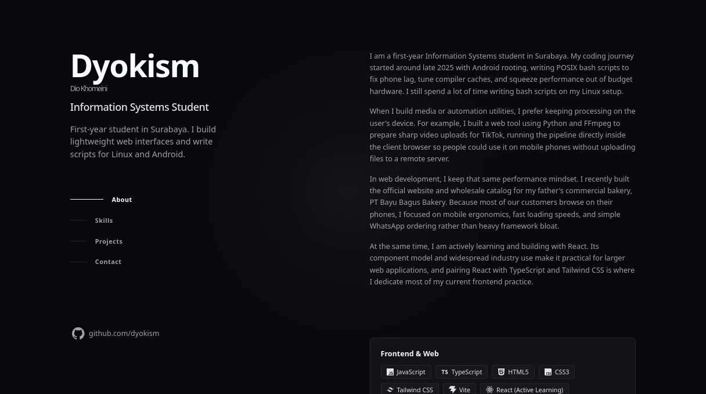

<div align="center">
  

  # Dyokism Portfolio
  *Minimalist personal developer portfolio with build-time HTML pre-rendering.*

  [Features](#features) • [Installation](#installation) • [Usage](#usage)
</div>

A lightweight developer portfolio built with HTML, Tailwind CSS, TypeScript, and Vite. It pre-renders project cards and live GitHub star counts into static HTML during build, eliminating layout shift and third-party rate limits.

## Features
- **Build-Time Pre-rendering** - Project cards and live GitHub star counts are baked into static HTML during build for instant loading and zero layout shift.
- **Strict TypeScript Architecture** - Full type safety across project schemas, DOM observers, spotlight animation routines, and Vite build hooks.
- **Mobile-First Layout** - Stretched card touch surfaces, high-contrast borders for OLED screens, and 16:9 media framing.
- **Fine-Pointer Spotlight** - Fluid mouse-tracking spotlight restricted to desktop pointers with reduced-motion compliance.
- **Production Security Headers** - Preconfigured Content-Security-Policy, HSTS, and frame protections for Vercel deployment.

## Installation
```bash
# Clone the repository
git clone https://github.com/dyokism/portfolio.git
cd portfolio

# Install dependencies via Bun
bun install
```

## Usage
```bash
# Start local dev server (http://localhost:5173/)
bun run dev

# Run TypeScript compiler check
bun run typecheck

# Build production bundle with typecheck
bun run build

# Preview production build locally (http://localhost:4173/)
bun run preview
```
